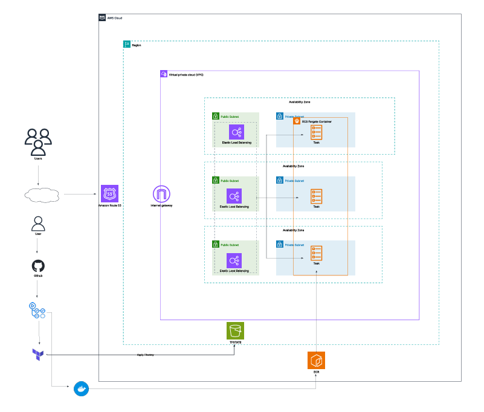

# VS Code in the Browser on AWS ECS Fargate

Self-hosted [code-server](https://github.com/coder/code-server) (VS Code in the browser), **built from source**, containerised, and deployed to AWS ECS Fargate with Terraform and a secure GitHub Actions pipeline.

---

## What this project is

This project explores what it takes to build, secure and operate a relatively complex, stateful application on AWS container infrastructure. 

I chose to build code-server: a complete VSCode development environment running in a container and accessible through a browser. Its heavier runtime requirements, active user sessions and workspace data introduce infrastructure considerations that aren't necessarily apparent when deploying simple stateless applications.

I chose to build it from source, rather than rely on a pre-built image. This gave me greater control over the software supply chain, dependency versions, patching and vulnerability management. 

The goal was to create an end-to-end deployment platform where a push to GitHub triggers a pipeline that builds, scans and tests the application before securely deploying it to AWS ECS Fargate.

**Highlights**

- Builds VS Code and code-server from source in a multi-stage Docker build, shipping only the release output on a slim, non-root runtime
- Two-layer Terraform (bootstrap + infrastructure) with remote state in S3
- CI/CD with GitHub Actions: lint, build, SBOM, vulnerability scan and smoke test on every push, then deployed to main
- HTTPS on a custom domain via ACM and Route 53

---

## Architecture

<!-- Architecture diagram -->

**Request flow:** browser → Route 53 → ALB (HTTPS, ACM certificate) → ECS Fargate task running code-server on port 8080.

**Network:** VPC across two Availability Zones. The ALB sits in public subnets; tasks only accept traffic from the ALB's security group.

---

## Tech stack

| Area | Tools |
|---|---|
| Container | Docker, Debian |
| Compute | ECS Fargate|
| Storage | ECR, S3 |
| Networking | VPC, ALB, SG, Route 53, ACM |
| IaC | Terraform |
| CI/CD | GitHub Actions, OIDC |
| Supply chain | Hadolint, Syft, Grype, Pinned SHAs |

---

## Key design decisions

| Decision | Why | Trade-off |
|---|---|---|
| Build code-server from source | Full control of build | Long, heavy build and download ( ~22 GB down to 1 GB image ) |
| Public subnets with SG-only |  |