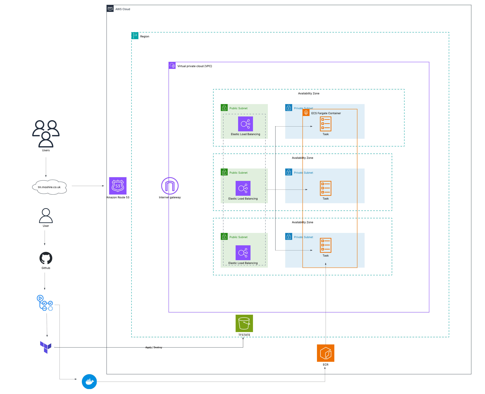
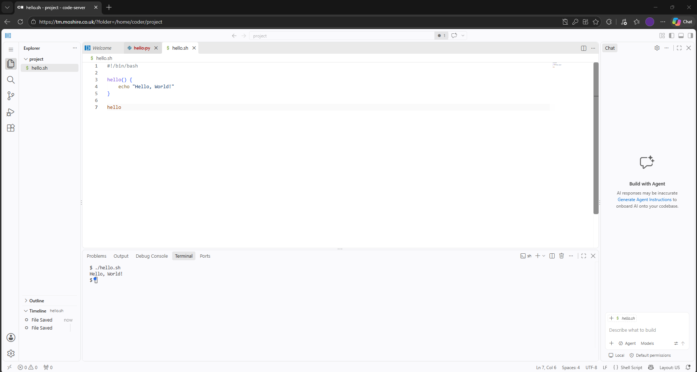

# VS Code in the Browser on AWS ECS Fargate

Self-hosted [code-server](https://github.com/coder/code-server) (VS Code in the browser), **built from source**, containerised, and deployed to AWS ECS Fargate with Terraform and a secure GitHub Actions pipeline.

---


## What this project is

This project explores what it takes to build, secure and operate a relatively complex, stateful application on AWS container infrastructure. 

I chose to build code-server: a complete VSCode development environment running in a container and accessible through a browser. Its heavier runtime requirements, active user sessions and workspace data introduce infrastructure considerations that aren't necessarily apparent when deploying simple stateless applications.

I chose to build it from source, rather than rely on a pre-built image. This gave me greater control over the software supply chain, dependency versions, patching and vulnerability management. 

The goal was to create an end-to-end deployment platform where a push to GitHub triggers a pipeline that builds, scans and tests the application before securely deploying it to AWS ECS Fargate.



**Highlights**

- Builds VS Code and code-server from source in a multi-stage Docker build, shipping only the release output on a slim, non-root runtime
- Two-layer Terraform (bootstrap + infrastructure) with remote state in S3
- CI/CD with GitHub Actions: lint, build, SBOM, vulnerability scan and smoke test on every push, then deployed to main
- HTTPS on a custom domain via ACM and Route 53

---

## Architecture


**Request flow:** browser → Route 53 → ALB (HTTPS, ACM certificate) → ECS Fargate task running code-server on port 8080.

**Network:** VPC across two Availability Zones. The ALB sits in public subnets; tasks only accept traffic from the ALB's security group.

---

## Tech stack

| Area | Tools |
|---|---|
| Container | Docker, Debian |
| Compute | ECS Fargate|
| Storage | ECR, S3 |
| Networking | VPC, ALB, SG, Route 53, ACM |
| IaC | Terraform |
| CI/CD | GitHub Actions, OIDC |
| Supply chain | Hadolint, Syft, Grype, Pinned SHAs |

---

## Key design decisions

| Decision | Why | Trade-off |
|---|---|---|
| Build code-server from source | Full control of build | Long, heavy build and download ( ~22 GB down to 1 GB image ) |
| `desired_count = 1` | code-server is stateful and single-user; replicas don't make sense | No redundancy, a task restart briefly drops the session |
| Separate bootstrap and infra Terraform layers | ECR, OIDC and IAM roles survive tearing down the app stack | Bootstrap state is kept locally |
| Pipeline owns the task definition `ignore_changes` | Terraform manages the service; the pipeline manages which image runs | Terraform no longer shows image drift in plans |
| Hand the image between jobs as an artifact `docker save` | The image deployed is byte-for-byte the one that was scanned and tested | ~1 GB artifact per `main` run (kept for 1 day) |
| Scanners run in a job without `id-token: write` | A compromised third-party action can't assume the AWS role | Extra job and artifact handover |

--- 

## The Docker build

A two-stage build: the builder compiles VS Code and code-server from source, and the runtime stage ships only the release output.

- **Builder** (`node:24-trixie`): pins the exact VS Code commit code-server uses, applies its patches, and reproduces VS Code's upstream CI to compile native modules
- **Runtime** (`debian:13-slim`): release output plus a few libraries, running as a non-root user
- Base images pinned by digest, the GitHub token is passed via a BuildKit secret mount, so it never lands in a layer

---

## Infrastructure

| Layer | Manages | State |
|---|---|---|
| `bootstrap/` | State bucket, ECR, GitHub OIDC provider, CI roles | Local |
| `infra/` | VPC, ALB, ECS, ACM, Route 53 | S3 |

---

## CI/CD


- `dev` runs every check with no AWS access, only `main` can deploy
- The OIDC trust policy is pinned to this repo's immutable IDs
- Scanners run in a job without AWS credentials, and every third-party action is pinned to a commit SHA

---

## Challenges

- **Native module build failure:** `native-keymap` failed to compile and the build docs didn't explain why. I traced VS Code's own CI pipeline (`setup-env.sh` and `preinstall.ts`) to find the setup it relies on, then reproduced it in the Dockerfile.
- **Critical Node CVE in VS Code's bundled runtime:** Grype flagged Node 24.20.0 with a critical, actively exploited CVE, even though my builder used a different Node version. VS Code downloads and bundles its own Node for the server, pinned in `remote/.npmrc`, so I overrode the pin to 24.22.1 and added the official checksums so VS Code's download check passes.
- **OIDC "not authorized" with a correct-looking trust policy:** The deploy job couldn't assume its AWS role even though the trust policy matched the repo and branch. Printing the token's claims showed GitHub includes the owner and repo IDs in the subject, so I pinned the trust policy to them. This is also more secure: a renamed or recreated repo can't inherit access.
- **Terraform undoing deployments:** The pipeline registers a new task definition on each deploy, but the next `terraform apply` would roll the service back to Terraform's revision. Adding `ignore_changes = [task_definition]` split ownership: Terraform manages the service, and the pipeline manages which image runs.

## Repository structure

```
├── app/                  # vendored code-server source
├── bootstrap/            # state bucket, ECR, OIDC, CI roles
├── infra/                # VPC, ALB, ECS, ACM, Route 53
├── .github/workflows/    # build and deploy pipelines
└── Dockerfile
```

---

## Running it

1. `terraform apply` in `bootstrap/`, then in `infra/`
2. Add the repository variables listed in `deploy.yaml`
3. Push to `main`

To tear down: `terraform destroy` in `infra/`.

